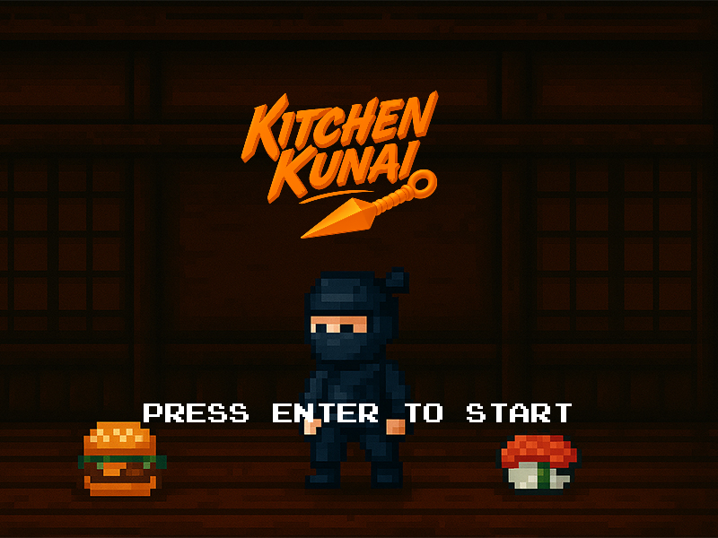
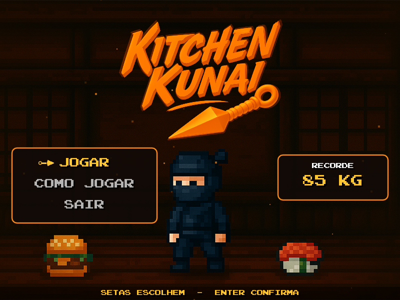
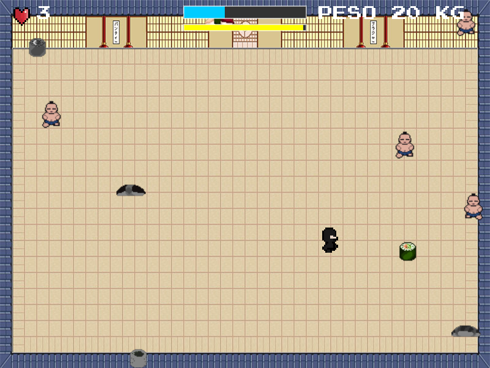
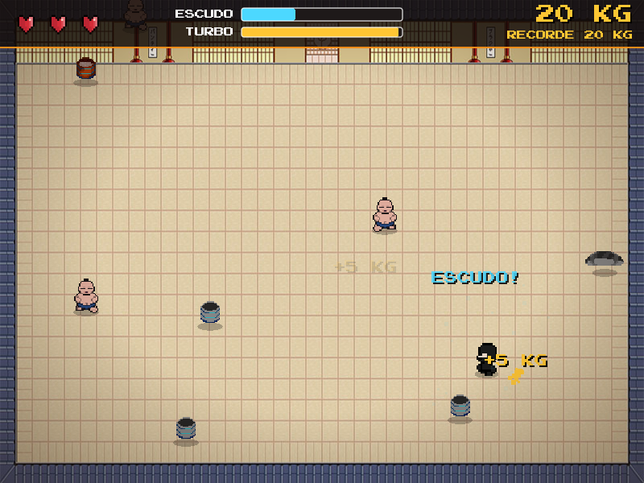
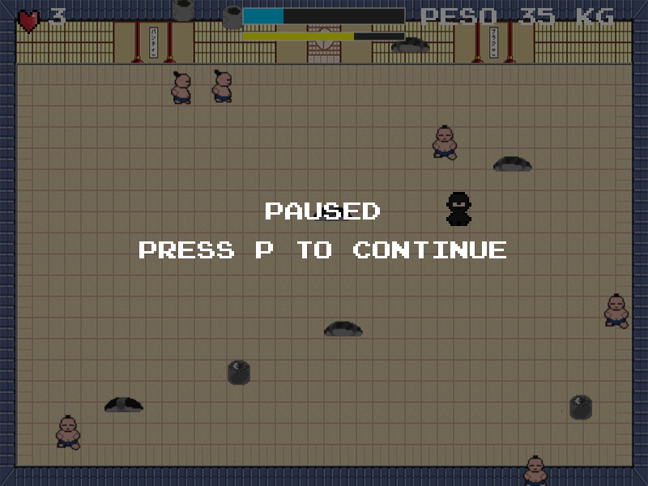
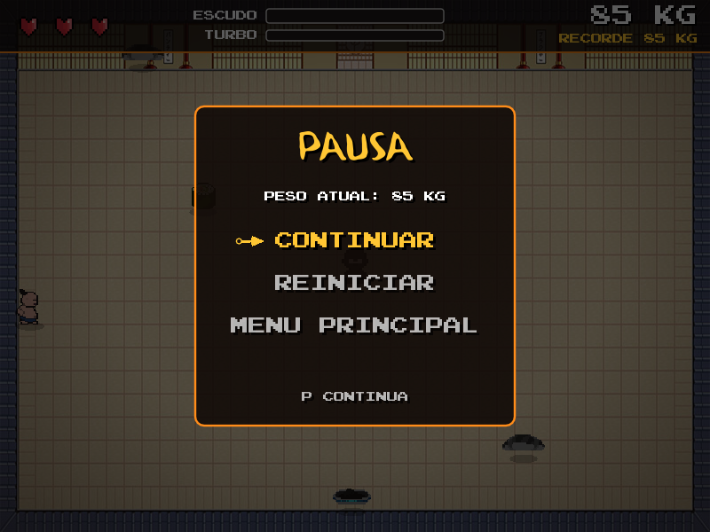
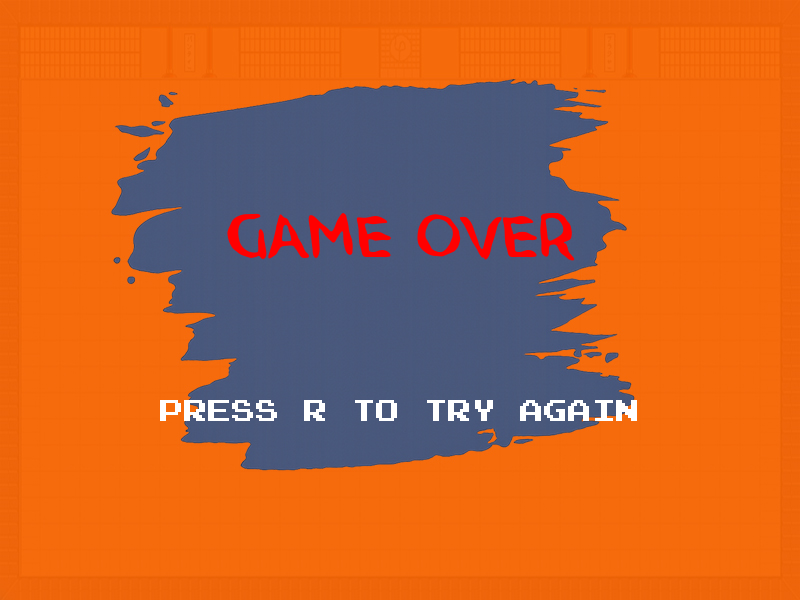
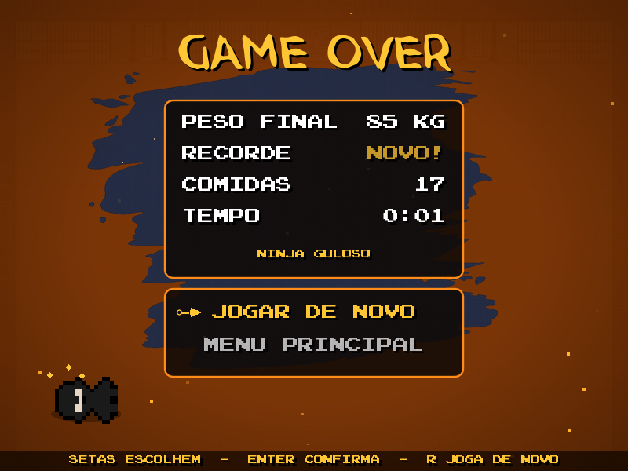

<div align="center">


<p>
  
  
  
</p>

</div>

**Kitchen Kunai** é um jogo em que um ninja precisa ganhar peso dentro de um dojo: comer as comidas boas, fugir das estragadas e aguentar os lutadores de sumô.

A ideia é inspirada no minijogo [ConSumo](https://youtu.be/ershQOeigTw), do jogo *Bully*. O projeto foi desenvolvido para a disciplina de Multimídia, do curso de Engenharia da Computação do Centro Universitário Regional de Espírito Santo do Pinhal.

## Duas versões

Este repositório guarda o jogo como foi entregue na disciplina e uma versão com o visual refeito depois.

| | [Versão original](versao-original) | [Versão nova](versao-nova) |
|---|---|---|
| **Para que serve** | O trabalho como foi entregue | A melhor forma de jogar hoje |
| **Como rodar** | `KitchenKunai.exe` ou LÖVE | LÖVE 11.5 |
| **Menus** | Telas com um comando em texto | Menus com opções, como jogar e pausa |
| **Colisão com lutador** | Empurrão instantâneo | Arremesso animado, girando no ar |
| **Fim de jogo** | Só o aviso de game over | Peso, recorde, comidas, tempo e título |
| **Recorde** | Salvo, mas não carregado ao abrir | Salvo e mostrado no menu |

## Antes e depois

<table>
  <tr>
    <th>Original</th>
    <th>Nova</th>
  </tr>
  <tr>
    <td></td>
    <td></td>
  </tr>
  <tr>
    <td></td>
    <td></td>
  </tr>
  <tr>
    <td></td>
    <td></td>
  </tr>
  <tr>
    <td></td>
    <td></td>
  </tr>
</table>

## Como jogar

Instale o [LÖVE 11.5](https://love2d.org/) e rode a versão que preferir a partir da raiz do repositório:

```bash
love versao-nova
```

```bash
love versao-original
```

No Windows, a versão original também abre direto por `versao-original/Executável/KitchenKunai.exe`.

Os controles e as regras de cada versão estão no README da pasta: [versão original](versao-original#como-jogar) e [versão nova](versao-nova#como-jogar).
