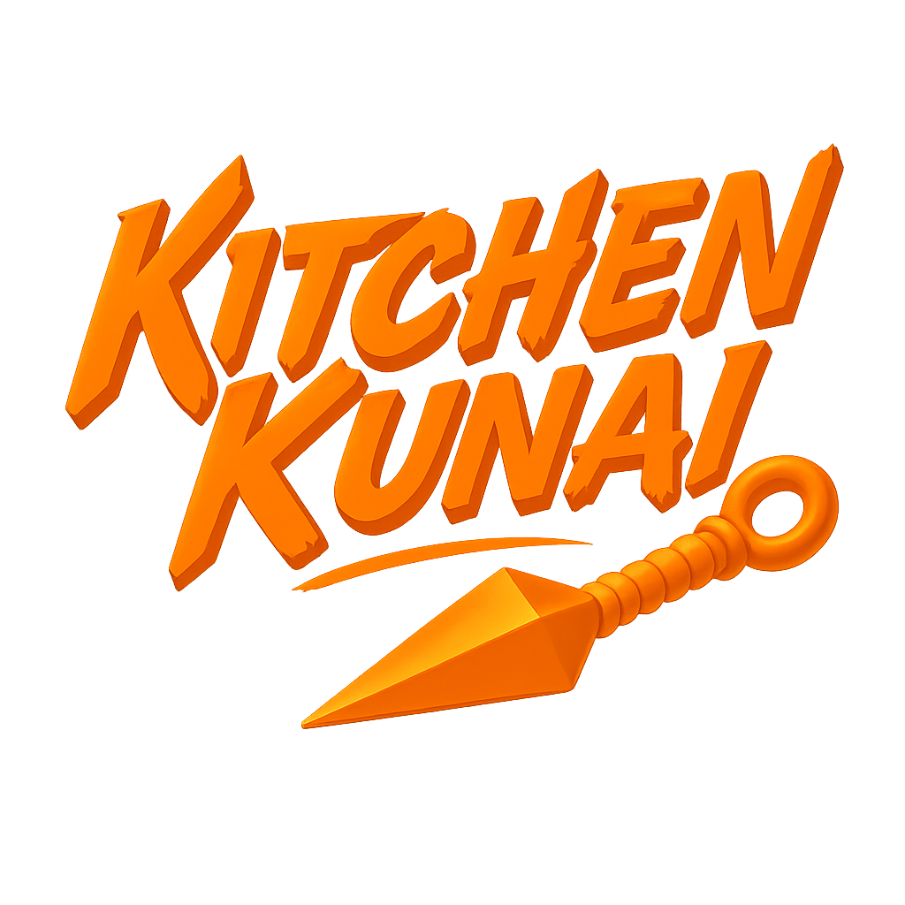
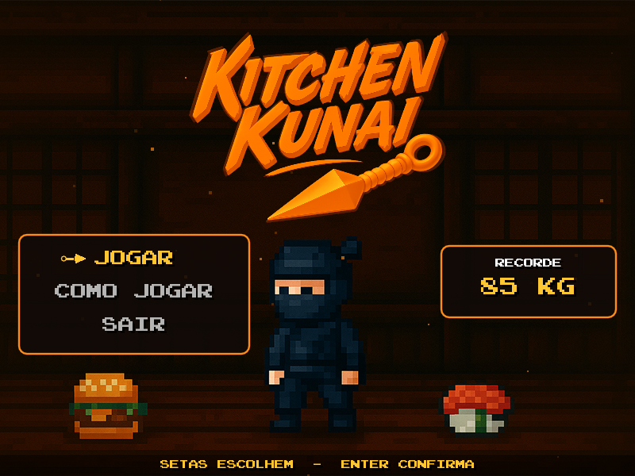
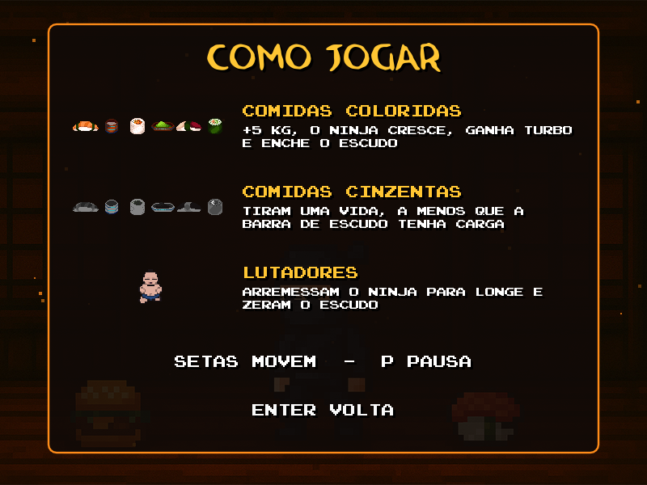
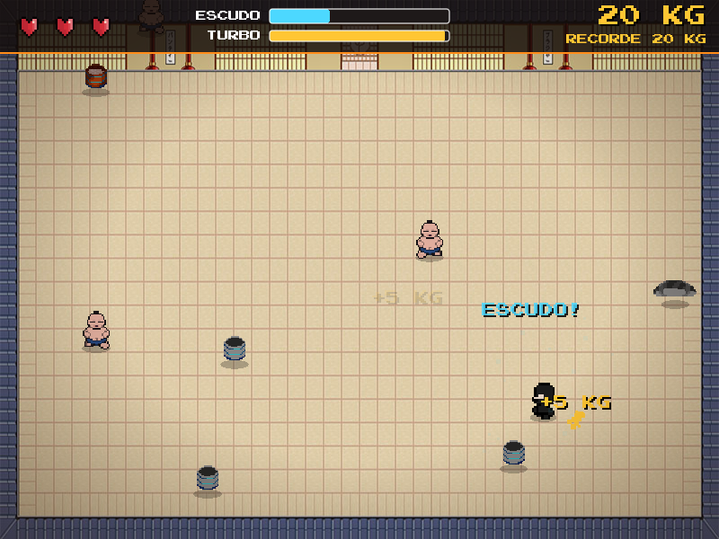
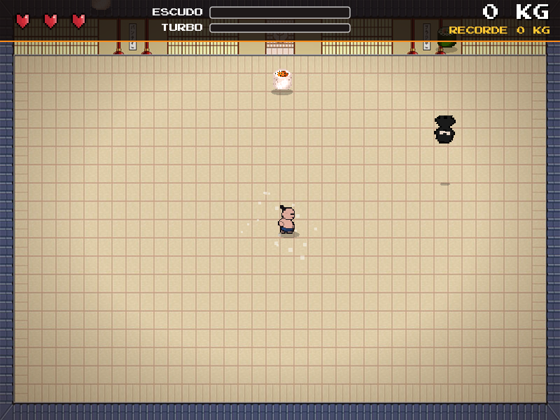
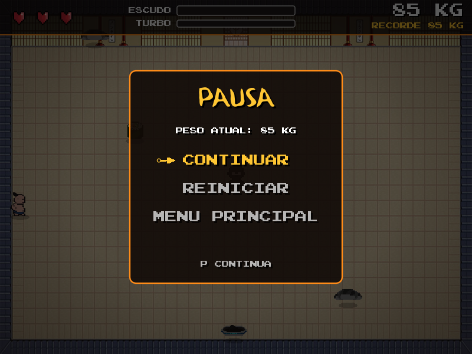
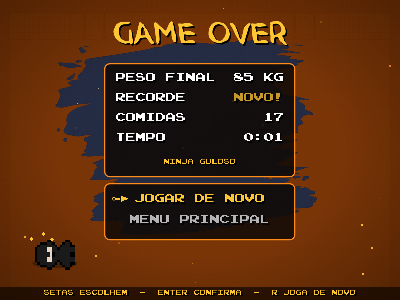

<div align="center">



<p>
  
  
</p>

</div>

> Esta é a **versão nova**, com visual refeito. A [versão original](../versao-original) continua no repositório, e a [página principal](..) compara as duas.

**Kitchen Kunai** é um jogo em que um ninja precisa ganhar peso dentro de um dojo: comer as comidas boas, fugir das estragadas e aguentar os empurrões dos lutadores de sumô.

A ideia é inspirada no minijogo [ConSumo](https://youtu.be/ershQOeigTw), do jogo *Bully*.

Foi desenvolvido para a disciplina de Multimídia, do curso de Engenharia da Computação do Centro Regional Universitário de Espírito Santo do Pinhal.

## Capturas

<table>
  <tr>
    <td align="center"><br><sub>Menu</sub></td>
    <td align="center"><br><sub>Como jogar</sub></td>
  </tr>
  <tr>
    <td align="center"><br><sub>Partida</sub></td>
    <td align="center"><br><sub>Arremesso</sub></td>
  </tr>
  <tr>
    <td align="center"><br><sub>Pausa</sub></td>
    <td align="center"><br><sub>Fim de jogo</sub></td>
  </tr>
</table>

## Como jogar

| Tecla | Ação |
|---|---|
| Setas | Movem o ninja e escolhem as opções dos menus |
| Enter | Confirma a opção |
| P ou Esc | Pausa e continua |
| R | Joga de novo depois do fim de jogo |

- **Comidas coloridas** valem 5 KG, fazem o ninja crescer, dão 2 segundos de turbo e enchem a barra de escudo.
- **Comidas cinzentas** tiram uma vida. Se a barra de escudo tiver carga, só ela é perdida.
- **Lutadores de sumô** arremessam o ninja para longe e zeram o escudo.
- **O jogo acelera** conforme o peso aumenta. A partida acaba quando as 3 vidas terminam, e o maior peso fica salvo como recorde.

## Como executar

Instale o [LÖVE 11.5](https://love2d.org/) e, nesta pasta, rode:

```bash
love .
```

## Estrutura

| Arquivo | Conteúdo |
|---|---|
| `main.lua` | Estados do jogo, regras e HUD |
| `screens.lua` | Menu, como jogar, pausa e fim de jogo |
| `player.lua` | Movimento, animação e dano do ninja |
| `food.lua` | Comidas boas e ruins |
| `enemy.lua` | Lutadores de sumô |
| `fx.lua` | Partículas, textos flutuantes, tremor e clarão de dano |
| `assets/` | Sprites, cenários, fontes e músicas |
