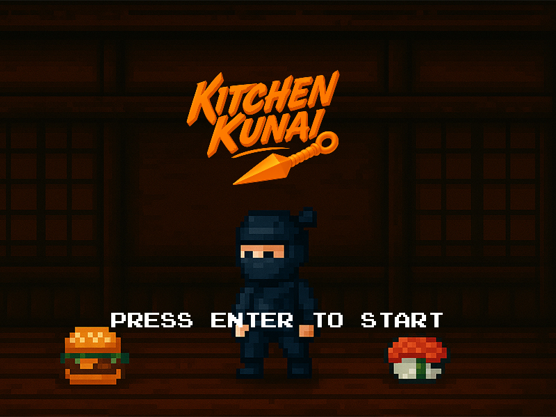
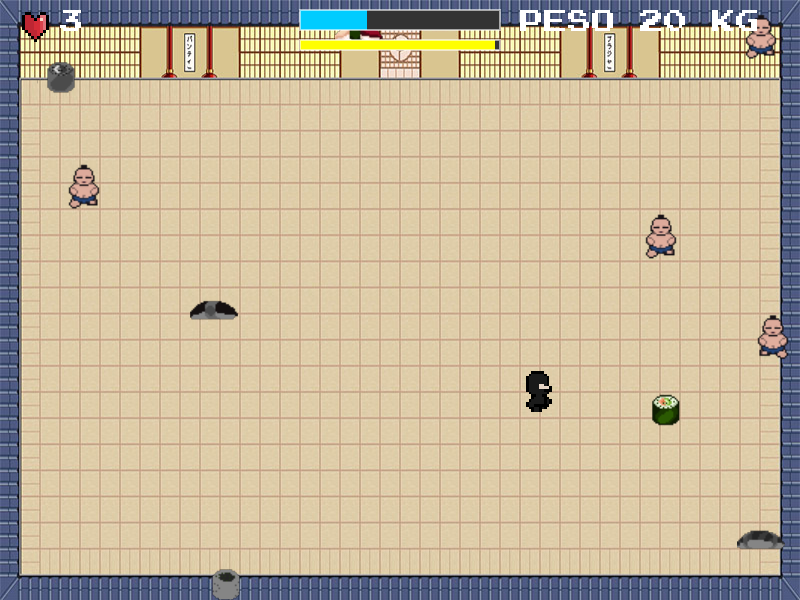
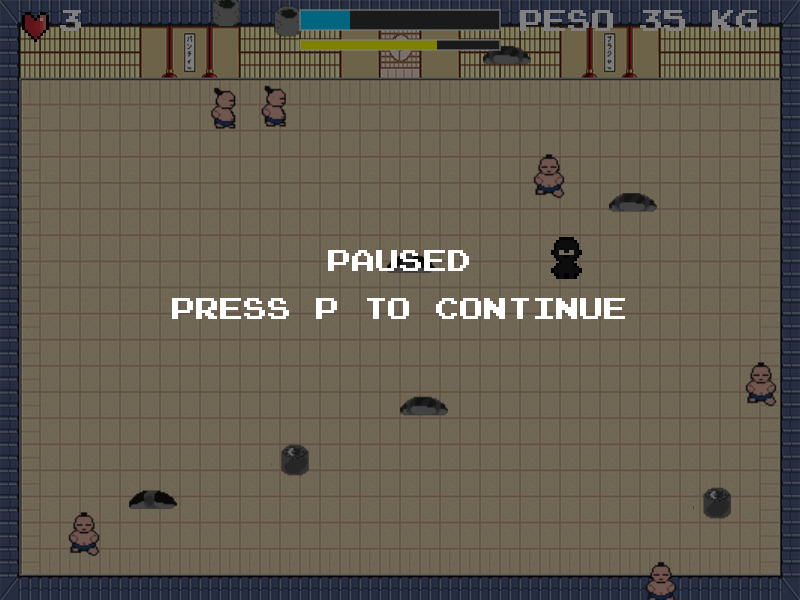
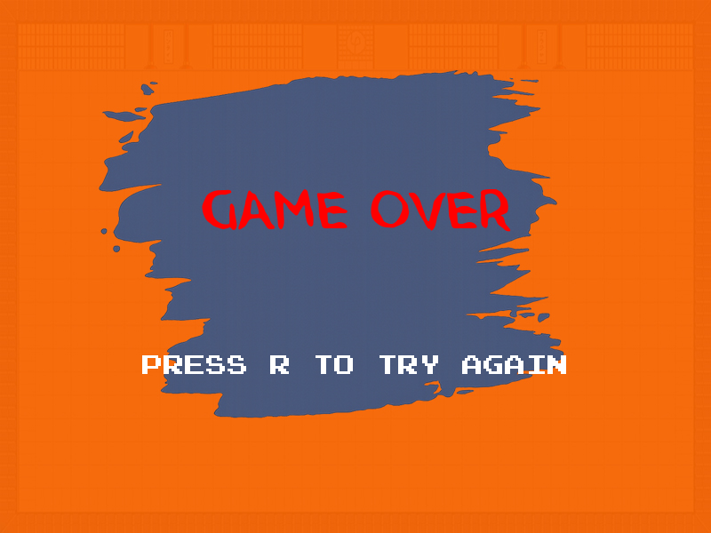

<div align="center">


<p>
  
  
  
</p>

</div>

> Esta é a **versão original**, com o código como foi entregue na disciplina. A [versão nova](../versao-nova) tem o visual refeito, e a [página principal](..) compara as duas.

**Kitchen Kunai** é um jogo em que um ninja precisa ganhar peso dentro de um dojo: comer as comidas boas, fugir das estragadas e aguentar os empurrões dos lutadores de sumô.

A ideia é inspirada no minijogo [ConSumo](https://youtu.be/ershQOeigTw), do jogo *Bully*.

Foi desenvolvido para a disciplina de Multimídia, do curso de Engenharia da Computação do Centro Universitário Regional de Espírito Santo do Pinhal.

## Capturas

<table>
  <tr>
    <td align="center"><br><sub>Menu</sub></td>
    <td align="center"><br><sub>Partida</sub></td>
  </tr>
  <tr>
    <td align="center"><br><sub>Pausa</sub></td>
    <td align="center"><br><sub>Fim de jogo</sub></td>
  </tr>
</table>

## Como jogar

| Tecla | Ação |
|---|---|
| Setas | Movem o ninja |
| Enter | Começa a partida |
| P | Pausa e continua |
| R | Recomeça depois do fim de jogo |

- **Comidas coloridas** valem 5 KG, fazem o ninja crescer, dão 2 segundos de velocidade extra e enchem a barra azul.
- **Comidas cinzentas** tiram uma vida. Se a barra azul tiver carga, só ela é perdida.
- **Lutadores de sumô** empurram o ninja e zeram a barra azul.
- **O jogo acelera** conforme o peso aumenta, e a partida acaba quando as 3 vidas terminam.

## Como executar

No Windows, abra `Executável/KitchenKunai.exe`.

Em qualquer sistema, instale o [LÖVE 11.5](https://love2d.org/) e, nesta pasta, rode:

```bash
love .
```

## Estrutura

| Arquivo | Conteúdo |
|---|---|
| `main.lua` | Estados do jogo, regras, telas e HUD |
| `player.lua` | Movimento, animação e dano do ninja |
| `food.lua` | Comidas boas e ruins |
| `enemy.lua` | Lutadores de sumô |
| `assets/` | Sprites, cenários, fontes e músicas |
| `Executável/` | Versão compilada para Windows |
